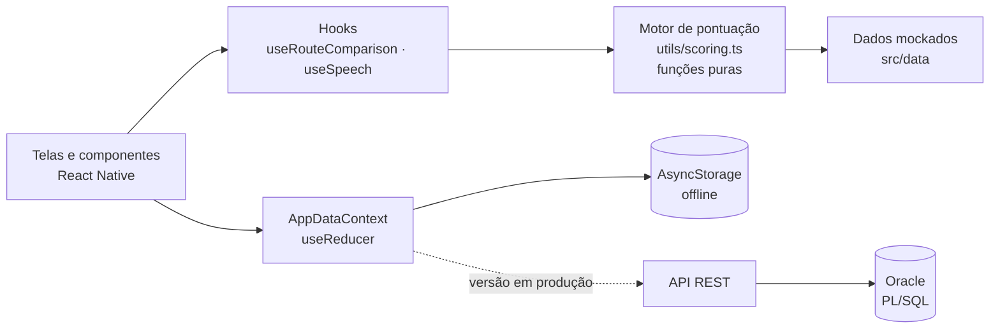
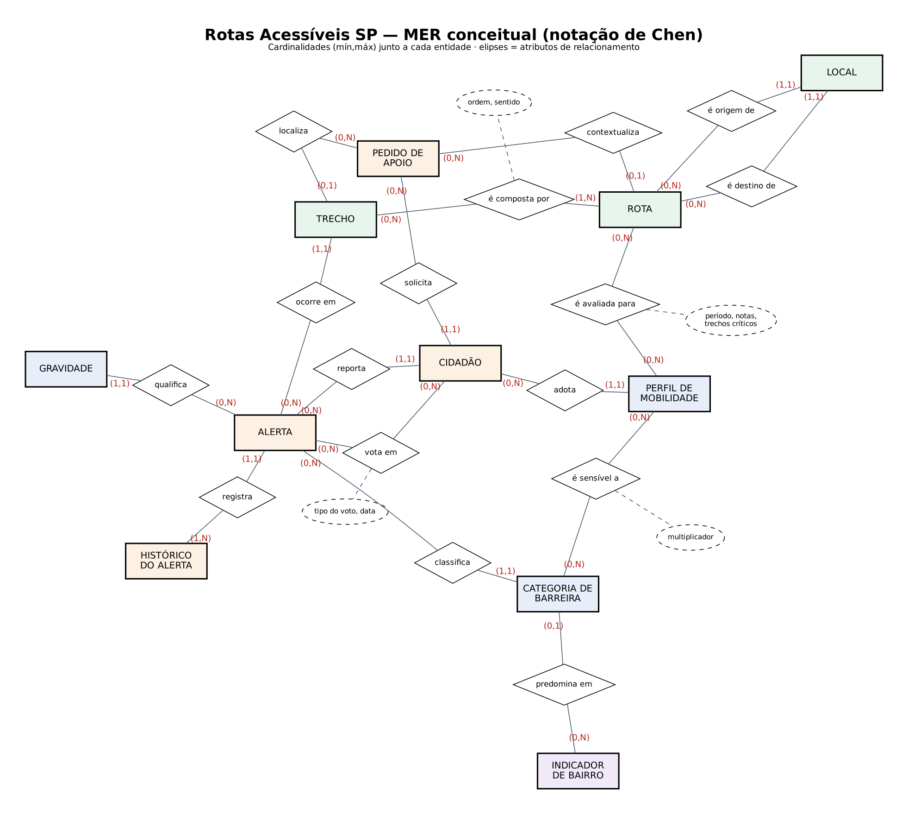
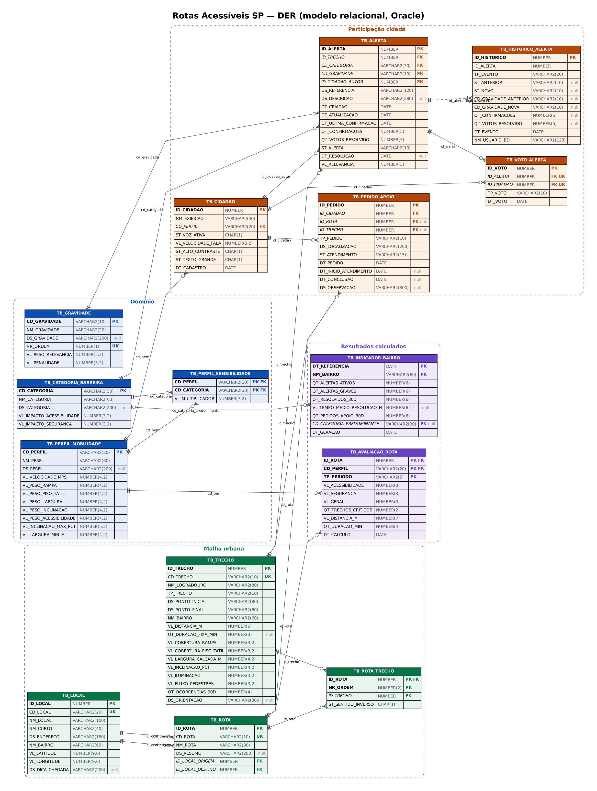

# Rotas Acessíveis SP

> Aplicativo mobile de **mobilidade urbana com rotas acessíveis e seguras** para pessoas com deficiência física ou visual, pessoas idosas e pedestres do centro de São Paulo.

**Global Solution 2 · CitizenTech: Tecnologia centrada no cidadão** · Turma **3SIOA**

| Integrante | RM |
|---|---|
| Caio Piato | [RM] |
| Fabio Henrique | [RM] |
| Gabriel Augusto | [RM] |

**Links da entrega**
- 🎥 Vídeo pitch técnico: [link do YouTube, não listado]
- 🎤 Vídeo pitch de venda: [link do YouTube, não listado]

---

## Sumário

1. [O problema](#1-o-problema)
2. [A solução](#2-a-solução)
3. [Relação com os ODS](#3-relação-com-os-ods)
4. [Funcionalidades](#4-funcionalidades)
5. [Tecnologias e justificativas](#5-tecnologias-e-justificativas)
6. [Como executar](#6-como-executar)
7. [Estrutura do projeto](#7-estrutura-do-projeto)
8. [Arquitetura](#8-arquitetura)
9. [Gerenciamento de memória e eficiência](#9-gerenciamento-de-memória-e-eficiência)
10. [Acessibilidade da interface](#10-acessibilidade-da-interface)
11. [Modelo de dados e PL/SQL](#11-modelo-de-dados-e-plsql)
12. [Descrição de funções, componentes e classes](#12-descrição-de-funções-componentes-e-classes)
13. [Limitações e próximos passos](#13-limitações-e-próximos-passos)

---

## 1. O problema

Para muita gente, uma calçada quebrada é só um incômodo. Para quem usa cadeira de rodas, tem deficiência visual ou é uma pessoa idosa, ela pode impedir o trajeto inteiro. Rampas interditadas, piso tátil interrompido, postes apagados, alagamentos, obras sem sinalização e elevadores de estação parados são barreiras do dia a dia. Mesmo assim, os aplicativos de mapa mostram o caminho **mais curto**, não o caminho que a pessoa **consegue percorrer** com segurança.

## 2. A solução

O **Rotas Acessíveis SP** compara as rotas possíveis entre dois pontos e dá a cada uma uma **nota de acessibilidade** e uma **nota de segurança**, calculadas de acordo com o **perfil de mobilidade** de quem vai usar:

- cadeirante / mobilidade reduzida;
- pessoa com deficiência visual;
- pessoa idosa;
- pedestre.

As informações ficam atualizadas porque a **própria comunidade** reporta barreiras e confirma ou encerra os alertas. Durante o trajeto, o app guia a pessoa **por voz** e avisa quando há um obstáculo próximo.

**Público beneficiado:** pessoas com deficiência física ou visual, pessoas idosas, gestantes, pessoas com carrinho de bebê e pedestres em geral nos grandes centros urbanos. A prefeitura e as subprefeituras também ganham, com os indicadores por bairro gerados pelo banco de dados.

## 3. Relação com os ODS

| ODS | Meta | Como o app contribui |
|---|---|---|
| **ODS 11** — Cidades e comunidades sustentáveis | 11.2 (transporte acessível, com atenção a pessoas com deficiência e idosos) e 11.7 (espaços públicos seguros, inclusivos e acessíveis) | Mostra as rotas acessíveis, inclusive combinando caminhada e metrô, e mapeia de forma colaborativa as barreiras nas calçadas |
| **ODS 10** — Redução das desigualdades | 10.2 (inclusão social de todos, independentemente de idade ou deficiência) | Dá mais autonomia a quem hoje depende de ajuda para circular com segurança pela cidade |

---

## 4. Funcionalidades

O login não conta como funcionalidade: o app abre com uma entrada rápida **"Entrar como Cidadão"**, sem cadastro.

| # | Funcionalidade | O que faz |
|---|---|---|
| 1 | **Buscador e comparador de rotas** | Origem e destino, perfil e período (dia/noite). Ranqueia as rotas pela nota geral, mostra os trechos críticos e **recomenda a melhor rota, explicando por quê** |
| 2 | **Reporte colaborativo de barreiras** | Formulário acessível com trecho (com busca), categoria, gravidade, referência e descrição. **Recalcula as notas das rotas na hora.** Um reporte repetido vira confirmação, sem duplicar |
| 3 | **Feed de alertas com validação** | Filtros por situação, categoria e gravidade. Botões **"Ainda está lá"** e **"Resolvido"** (1 voto por pessoa). A relevância é recalculada a cada voto, e o alerta é encerrado por votação ou pelo próprio autor |
| 4 | **Navegação assistida** | Passo a passo com botões grandes e **leitura em voz alta** (`expo-speech`). Avisa os obstáculos a menos de 60 m por voz e vibração. O botão **Alerta Rápido** permite pedir apoio, avisar um contato ou ligar para o SAMU (192) e a PM (190) |

**Extras**
- Modo **alto contraste** e **texto grande** em todas as telas.
- **Funciona offline**: os dados ficam no aparelho.
- Histórico dos pedidos de apoio.
- Opção de **restaurar os dados de demonstração**.

---

## 5. Tecnologias e justificativas

| Tecnologia | Por que escolhemos |
|---|---|
| **React Native + Expo (SDK 58)** | Um único código para Android e iOS. Com o Expo Go, o app roda no celular em segundos, sem precisar compilar código nativo |
| **TypeScript (modo strict)** | Todo o domínio é tipado (perfis, trechos, alertas, avaliações), e os erros aparecem antes de rodar |
| **@react-native-async-storage/async-storage** | Persistência local, para o app funcionar **sem internet**, como pede o desafio |
| **expo-speech** | Síntese de voz nativa do aparelho, em pt-BR, essencial para pessoas com deficiência visual |
| **React Navigation (stack + bottom tabs)** | Navegação nativa, com suporte a leitores de tela e rótulos acessíveis nas abas |
| **Context API + useReducer** | Estado global previsível, sem bibliotecas extras. Separamos estado e ações em contextos diferentes, para evitar re-renderizações |
| **Oracle Database + PL/SQL** | Back-end proposto para a versão em produção: as regras de negócio e as automações ficam no banco |

---

## 6. Como executar

### 6.1 Aplicativo

**Pré-requisitos**
- Node.js LTS (20 ou superior).
- O app **Expo Go** no celular (Android ou iOS), ou um emulador.

```bash
git clone [URL do repositório]
cd rotas-acessiveis
npm install
npx expo start
```

Leia o QR Code com o Expo Go (no Android) ou com a câmera (no iOS). Para conferir a tipagem, rode:

```bash
npx tsc --noEmit
```

**Roteiro rápido de teste**
1. Toque em **"Entrar como Cidadão"**.
2. Na aba **Rotas**, escolha *Theatro Municipal → Catedral da Sé*, com o perfil **Cadeirante** e horário **Dia**. A recomendada é o *Vale do Anhangabaú*, porque há um alerta de **elevador parado** na Estação Sé.
3. Troque o perfil para **Pedestre**: o metrô passa a ser o recomendado.
4. Em **Reportar**, registre uma barreira e veja as rotas afetadas.
5. Em **Alertas**, confirme um alerta ou marque como resolvido.
6. Em **Rotas › Iniciar**, ouça a navegação por voz e aguarde o aviso de obstáculo.
7. Em **Ajustes**, você pode **restaurar os dados de demonstração** a qualquer momento.

> A navegação usa um deslocamento **simulado** (acelerado, sem GPS), para dar para demonstrar os avisos de proximidade em sala.

### 6.2 Banco de dados (Oracle)

No **Oracle SQL Developer**, rode cada arquivo com **F5 (Executar Script)**, nesta ordem:

| Ordem | Arquivo | Conteúdo |
|---|---|---|
| 1 | `database/01_ddl.sql` | 15 tabelas, restrições, índices e comentários (pode ser executado várias vezes) |
| 2 | `database/02_plsql.sql` | Pacote `PKG_ROTAS_ACESSIVEIS`, 2 triggers, 3 views e o job diário |
| 3 | `database/03_dados_iniciais.sql` | Os mesmos dados de demonstração do app |
| 4 | `database/04_testes.sql` | Demonstração de cada rotina, com o resultado esperado comentado |

O detalhamento completo está em [`database/README.md`](database/README.md).

---

## 7. Estrutura do projeto

```text
rotas-acessiveis/
├── App.tsx                  # Providers (área segura → tema → dados) + navegação
├── src/
│   ├── types/               # Tipos do domínio e da navegação
│   ├── data/                # Catálogos e dados mockados de São Paulo (locais, trechos, rotas, alertas)
│   ├── theme/               # Tema padrão e alto contraste, escala tipográfica, área de toque mínima
│   ├── utils/               # Motor de pontuação, textos falados, formatação e geração de ids
│   ├── context/             # AsyncStorage (storage.ts), ThemeContext e AppDataContext
│   ├── hooks/               # useSpeech, useRouteData, useTimedMessage
│   ├── components/          # Componentes acessíveis e memoizados
│   ├── screens/             # Boas-vindas, Rotas, Reportar, Alertas, Navegação assistida, Ajustes
│   └── navigation/          # Pilha raiz + abas inferiores
└── database/                # Scripts Oracle (DDL, PL/SQL, dados, testes), MER, DER e documentação
```

---

## 8. Arquitetura



**Como a nota é calculada (resumo)**
1. **Acessibilidade do trecho** (0–100): rampas, piso tátil, largura da calçada e inclinação, cada um com o peso do perfil escolhido. Por exemplo, a inclinação pesa 40% para pessoas idosas e o piso tátil pesa 50% para pessoas com deficiência visual.
2. **Segurança do trecho** (0–100): iluminação, movimento de pedestres e ocorrências nos últimos 90 dias. À noite, a iluminação pesa mais.
3. **Penalidades da comunidade:** cada alerta ativo desconta pontos. O desconto depende da gravidade, da confiança do alerta (confirmações × votos de resolvido) e da sensibilidade do perfil àquela categoria.
4. **Rota:** média ponderada pela distância de cada trecho. O **pior trecho também pesa**, porque uma rota é tão acessível quanto o seu ponto mais difícil.
5. **Trecho crítico:** nota abaixo de 45, alerta grave confirmado ou barreira estrutural para o perfil (por exemplo, inclinação acima de 8,33%, o limite da NBR 9050, para cadeirantes).

---

## 9. Gerenciamento de memória e eficiência

Cada prática está marcada no código com o comentário `// [MEMORY MANAGEMENT]` (40 ocorrências).

| Prática | Onde | Benefício |
|---|---|---|
| **FlatList otimizada** (`keyExtractor`, `initialNumToRender`, `maxToRenderPerBatch`, `windowSize`, `removeClippedSubviews`, `extraData`) | `RoutesScreen`, `AlertsScreen`, `AssistedNavigationScreen`, `SelectModal` | Renderiza só o que está na tela e em pequenos lotes, o que reduz o uso de memória em listas longas |
| **`React.memo`** com comparador personalizado | `RouteCard`, `AlertCard`, `NavigationStepItem`, `FilterChip`, `ScoreMeter` e outros | Ao votar num alerta ou expandir uma rota, só o item alterado é redesenhado |
| **`useMemo`** | Ranking das rotas, filtros do feed, opções das listas, tema | Cálculos refeitos só quando os dados mudam |
| **`useCallback`** | Todos os handlers passados para os itens | Referências estáveis, o que faz o `React.memo` funcionar |
| **Limpeza no `useEffect`** | `useSpeech` (`Speech.stop()`), navegação (`clearInterval`, `Vibration.cancel()`), `useTimedMessage` (`clearTimeout`), listeners de `AppState` e `AccessibilityInfo` (`remove()`) | Nada continua rodando, falando ou ocupando memória depois que a tela fecha |
| **Cancelamento de operações assíncronas** | Leitura do AsyncStorage com a flag `cancelled`; `mountedRef` no `useSpeech` | Evita `setState` em componente desmontado (vazamento de memória) |
| **Gravação com debounce (400 ms)** | `AppDataContext` | Várias alterações seguidas viram uma única escrita no disco; grava na hora se o app for para segundo plano |
| **Contextos separados** | Estado × ações e tema × dados | Um botão que só dispara ações não re-renderiza quando a lista de alertas muda |
| **Funções puras no motor de pontuação** | `utils/scoring.ts` | Podem ser memoizadas com segurança e testadas isoladamente |
| **Limites de crescimento** | No máximo 50 pedidos de apoio guardados | O armazenamento local não cresce sem limite |

---

## 10. Acessibilidade da interface

- Toda área de toque tem pelo menos **48 × 48 dp** (`MIN_TOUCH_TARGET`).
- **Alto contraste** (fundo preto, texto branco e destaques em amarelo, com contraste de 7:1 ou mais) e **texto grande** (+20%), com toggles no topo de todas as telas e salvos no aparelho.
- `accessibilityLabel`, `accessibilityRole`, `accessibilityState` e `accessibilityHint` em todos os componentes interativos. Grupos de opções usam `radiogroup`, e as notas usam `progressbar`.
- **Nada depende só da cor**: os níveis de nota e a gravidade sempre vêm com ícone e texto.
- Mensagens de erro e confirmação são anunciadas pelo leitor de tela (`announceForAccessibility` e `accessibilityLiveRegion`).
- A fonte do sistema é respeitada (escala de fonte do Android e do iOS).

---

## 11. Modelo de dados e PL/SQL

| MER (conceitual) | DER (relacional) |
|---|---|
|  |  |

- **15 tabelas.** Os N:N viraram tabelas associativas: perfil × categoria, cidadão × alerta (votos), rota × trecho, rota × perfil (avaliações).
- O pacote **`PKG_ROTAS_ACESSIVEIS`** tem **4 funções e 10 procedures**. Ele automatiza o **registro de solicitações** (reporte com deduplicação), o **acompanhamento de atendimentos** (votação comunitária e status dos pedidos de apoio) e a **geração de indicadores** por bairro.
- **2 triggers**: um mantém datas e relevância e o outro grava a auditoria. Há também **3 views** e um **job diário** (`DBMS_SCHEDULER`).
- As regras de cálculo são **as mesmas do app**: as 72 avaliações de rota (9 rotas × 4 perfis × dia/noite) foram conferidas contra o motor do app e deram números idênticos.

A documentação completa (entidades, cardinalidades, regras de negócio e códigos de erro) está em [`database/README.md`](database/README.md).

---

## 12. Descrição de funções, componentes e classes

### `src/types`
| Arquivo | Descrição |
|---|---|
| `index.ts` | Tipos do domínio: `Place`, `Segment` (trecho com métricas), `RouteDef`, `CommunityAlert`, `MobilityProfile`, `AppSettings`, `PersistedAppState`, além dos resultados `SegmentEvaluation`, `RouteEvaluation` e `RouteComparison` |
| `navigation.ts` | Parâmetros das rotas de navegação (`RootStackParamList`, `MainTabParamList`) e tipagem global do `useNavigation()` |

### `src/data`
| Arquivo | Descrição |
|---|---|
| `catalog.ts` | `CATEGORIES` (8 tipos de barreira e seu impacto), `SEVERITIES` (peso e penalidade), `PROFILES` (pesos, velocidade e sensibilidade de cada perfil), `DEFAULT_SETTINGS`, `RESOLVE_MIN_VOTES`, `EMERGENCY_NUMBERS` |
| `places.ts` | 6 locais reais do centro de SP (`PLACES`, `PLACES_BY_ID`) |
| `segments.ts` | 26 trechos com métricas de acessibilidade e segurança; `segmentLabel()` gera o rótulo legível de um trecho |
| `routes.ts` | 9 rotas alternativas para 3 trajetos (válidas nos dois sentidos) |
| `initialAlerts.ts` | `createInitialAlerts()` e `createSeedState()`: os alertas iniciais, com datas relativas ao primeiro uso |

### `src/utils`
| Função | Descrição |
|---|---|
| `scoring.ts` › `evaluateSegment()` | Calcula as notas de acessibilidade, segurança e geral de um trecho, aplica as penalidades dos alertas e indica se o trecho é crítico |
| `evaluateRoute()` | Agrega os trechos numa nota de rota (média ponderada + pior trecho), com distância, tempo e avisos |
| `compareRoutes()` | Avalia todas as rotas de um trajeto, ordena e gera a recomendação com os motivos |
| `alertConfidence()` / `alertRelevance()` | Confiança (Laplace) e relevância de 0 a 100 de um alerta (gravidade × atualidade × confiança) |
| `shouldAutoResolve()` | Regra de encerramento coletivo (pelo menos 3 votos de resolvido e mais votos que confirmações) |
| `resolvePeriod()`, `findRoutesForPair()`, `getReachableDestinationIds()`, `routeKey()` / `parseRouteKey()`, `buildAlertFeed()` | Período do dia, busca de rotas, destinos alcançáveis, chave da rota e montagem do feed ordenado |
| `announcements.ts` | Textos falados: `buildRouteIntro()`, `buildStepAnnouncement()`, `buildHazardAnnouncement()` e `buildArrivalAnnouncement()` |
| `format.ts` | `formatDistance()`, `formatSpokenDistance()`, `formatDuration()`, `formatRelativeTime()`, `normalizeForSearch()` e `pluralize()` |
| `id.ts` | `createId()`: id único local, sem dependências |

### `src/context`
| Módulo | Descrição |
|---|---|
| `storage.ts` | Camada do AsyncStorage com **validação defensiva**: `loadAppState()`, `saveAppState()`, `loadDisplayPreferences()`, `saveDisplayPreferences()` e `clearAllData()`. Dados corrompidos são descartados e o app volta aos dados iniciais |
| `ThemeContext.tsx` | `ThemeProvider` / `useAppTheme()`: alto contraste, texto grande e detecção do leitor de tela |
| `AppDataContext.tsx` | `AppDataProvider` com `useReducer`: sessão, preferências, alertas, votos e pedidos de apoio. Ações: `startSession`, `updateSettings`, `reportBarrier`, `confirmAlert`, `markAlertResolved`, `registerSupportRequest` e `resetDemoData`. Hooks: `useAppState()` e `useAppActions()` |

### `src/hooks`
| Hook | Descrição |
|---|---|
| `useSpeech` | `speak()` e `stop()` em pt-BR com o `expo-speech`; interrompe a fala ao desmontar a tela ou ao desligar a voz |
| `useRouteData` | `useScoringContext()`, `useRouteComparison()`, `useRouteEvaluation()` e `useAlertFeed()`: os cálculos derivados, todos memoizados |
| `useTimedMessage` | Aviso temporário anunciado ao leitor de tela, com o timer sempre limpo |

### `src/components`
| Componente | Descrição |
|---|---|
| `AppText` | Texto com a escala tipográfica do tema |
| `AccessibleButton`, `IconButton` | Botões com área de toque mínima de 48 dp, variantes de cor e rótulos para leitor de tela |
| `DisplayToggles` | Toggles de **Alto contraste** e **Texto grande** (`role="switch"`) |
| `AppHeader` | Cabeçalho com área segura, botão voltar e toggles |
| `ScoreMeter`, `SeverityBadge` | Nota com barra e ícone (`progressbar`) e selo de gravidade |
| `RouteCard`, `AlertCard`, `NavigationStepItem` | Itens de lista memoizados das três telas principais |
| `FilterChip`, `ProfileSelector` | Opções selecionáveis (`radio`) |
| `SelectModal`, `PickerField` | Seleção em tela cheia com busca e FlatList otimizada |
| `EmptyState`, `StatusBanner` | Estado vazio e aviso de sucesso ou erro |

### `src/screens` e `src/navigation`
| Tela | Descrição |
|---|---|
| `WelcomeScreen` | Entrada rápida "Entrar como Cidadão" + escolha do perfil |
| `RoutesScreen` | **Funcionalidade 1**: buscador e comparador |
| `ReportScreen` | **Funcionalidade 2**: reporte com validação |
| `AlertsScreen` | **Funcionalidade 3**: feed com filtros e votação |
| `AssistedNavigationScreen` | **Funcionalidade 4**: navegação por voz, avisos de proximidade e Alerta Rápido |
| `SettingsScreen` | Perfil, voz, exibição, período, histórico de apoio e restauração dos dados |
| `AppNavigator` | Pilha raiz (Boas-vindas → Abas → Navegação assistida) e 4 abas, com selo de alertas graves |

---

## 13. Limitações e próximos passos

- **Dados de demonstração:** os locais e as vias são reais, mas as métricas e os alertas são **mockados**. Não são dados oficiais.
- **Navegação simulada:** o próximo passo é usar o `expo-location` (GPS) e o *geofencing* dos alertas.
- **Banco não conectado ao app:** o app é offline por definição do desafio. A versão em produção teria uma API REST sobre o banco Oracle.
- **Próximos passos:**
  - integrar dados abertos da Prefeitura de São Paulo (GeoSampa) e do Metrô;
  - aceitar fotos nos reportes;
  - notificar o reporte à subprefeitura e acompanhar a resposta.

---

<sub>Projeto acadêmico desenvolvido para a Global Solution 2 (CitizenTech).</sub>
