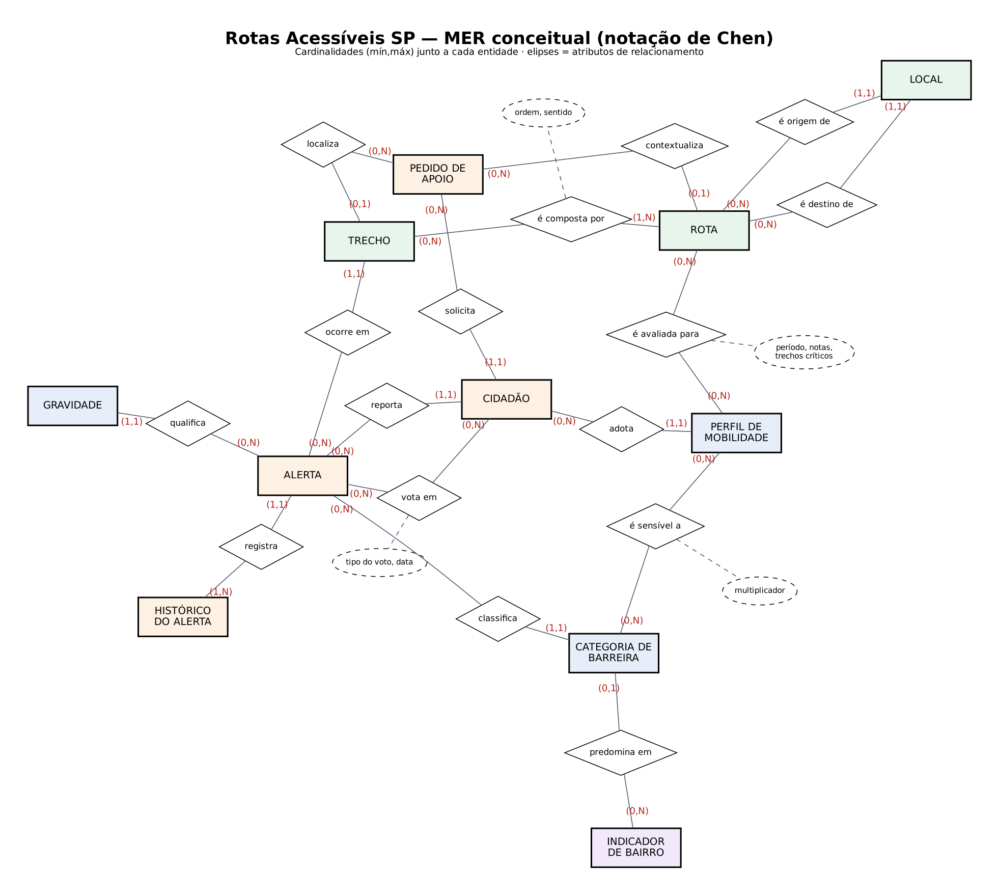
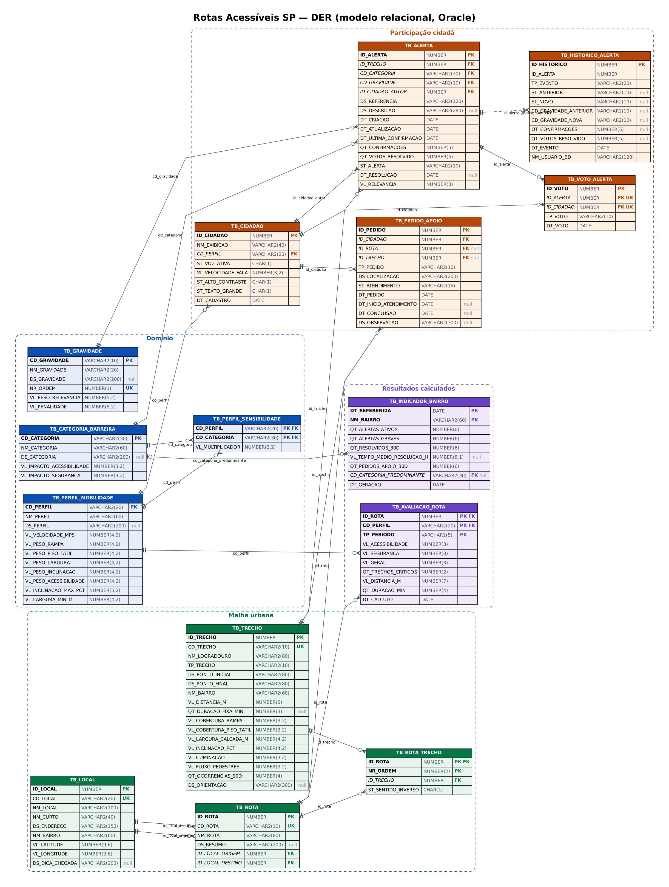

# Banco de Dados — Rotas Acessíveis SP

Modelagem e automação em **Oracle Database (19c ou superior)** da solução *Rotas Acessíveis SP* (Global Solution 2 — CitizenTech).

O aplicativo funciona offline (AsyncStorage) para demonstração. Este banco representa o **back-end da versão em produção**: centraliza os reportes de todos os cidadãos, aplica as regras de validação comunitária, recalcula as notas das rotas e gera indicadores para a gestão pública. As regras PL/SQL são **as mesmas do app** (`src/utils/scoring.ts` e `src/context/AppDataContext.tsx`). As 72 avaliações de rota (9 rotas × 4 perfis × dia/noite) foram conferidas contra o motor do app e dão os mesmos números.

---

## 1. Como executar

No **Oracle SQL Developer**, conectado ao seu usuário, abra cada arquivo e rode com **F5 (Executar Script)**, nesta ordem:

| Ordem | Arquivo | O que faz |
|---|---|---|
| 1 | `01_ddl.sql` | Apaga objetos antigos (pode rodar de novo) e cria 15 tabelas, restrições, índices e comentários |
| 2 | `02_plsql.sql` | Cria o pacote `PKG_ROTAS_ACESSIVEIS`, 2 triggers, 3 views e o job diário |
| 3 | `03_dados_iniciais.sql` | Carrega os mesmos dados do app e calcula as notas iniciais |
| 4 | `04_testes.sql` | Demonstra cada rotina, com o resultado **esperado** comentado em cada passo |

Para ver as mensagens do `DBMS_OUTPUT`, os scripts já ativam `SET SERVEROUTPUT ON`.

> O job diário precisa do privilégio `CREATE JOB`. Se o usuário não tiver, o script só avisa e continua. As mesmas rotinas podem ser chamadas manualmente (TESTE 10).

---

## 2. MER — Modelo Entidade-Relacionamento (conceitual)

### Entidades

| Entidade | Descrição | Atributos principais |
|---|---|---|
| **Perfil de mobilidade** | Cadeirante, deficiência visual, pessoa idosa, pedestre | código, nome, velocidade, pesos de rampa / piso tátil / largura / inclinação, peso da acessibilidade, inclinação máxima, largura mínima |
| **Categoria de barreira** | Tipos de problema que o cidadão reporta | código, nome, impacto na acessibilidade, impacto na segurança |
| **Gravidade** | Baixa, média, alta, crítica | código, ordem, peso de relevância, penalidade |
| **Cidadão** | Usuário do app (entrada rápida, sem login) | nome de exibição, perfil, preferências de voz e exibição |
| **Local** | Origem/destino (estações, hospital, museu…) | código, nome, endereço, bairro, latitude, longitude |
| **Trecho** | Segmento de via com métricas | logradouro, tipo, pontos inicial/final, distância, cobertura de rampa e piso tátil, largura, inclinação, iluminação, fluxo de pedestres, ocorrências em 90 dias |
| **Rota** | Caminho alternativo entre dois locais | código, nome, resumo |
| **Alerta** | Barreira ou risco reportado | referência, descrição, datas, confirmações, votos de resolvido, status, relevância |
| **Histórico do alerta** | Trilha de auditoria | evento, status anterior/novo, gravidade anterior/nova, data, usuário |
| **Pedido de apoio** | Botão "Alerta rápido" da navegação | tipo, localização, status do atendimento, datas |
| **Indicador de bairro** | Indicadores diários para a gestão pública | data, bairro, alertas ativos e graves, resolvidos em 30 dias, tempo médio de resolução, pedidos de apoio |

### Relacionamentos e cardinalidades

| Relacionamento | Cardinalidade | Leitura |
|---|---|---|
| Perfil **adota** Cidadão | 1 : N | Cada cidadão tem 1 perfil; um perfil tem 0..N cidadãos |
| Perfil **é sensível a** Categoria | N : N (atributo: multiplicador) | Ex.: falta de rampa pesa 1,6× para cadeirante |
| Cidadão **reporta** Alerta | 1 : N | Todo alerta tem 1 autor |
| Cidadão **vota em** Alerta | N : N (atributos: tipo, data) | No máximo 1 voto por cidadão por alerta |
| Alerta **ocorre em** Trecho | N : 1 | O alerta pertence a um trecho; um trecho tem 0..N alertas |
| Categoria **classifica** / Gravidade **qualifica** Alerta | 1 : N | — |
| Alerta **registra** Histórico | 1 : N | Gerado automaticamente por trigger |
| Local **é origem de** / **é destino de** Rota | 1 : N (dois relacionamentos) | Origem ≠ destino |
| Rota **é composta por** Trecho | N : N (atributos: ordem, sentido) | Um trecho pode estar em várias rotas |
| Rota **é avaliada para** Perfil | N : N (atributos: período, notas, trechos críticos) | Resultado do cálculo PL/SQL |
| Cidadão **solicita** Pedido de apoio | 1 : N | — |
| Rota / Trecho **contextualiza** Pedido | 0..1 : N | Opcional: onde a pessoa estava |
| Categoria **predomina em** Indicador | 0..1 : N | Categoria mais frequente no bairro |

---

## 3. DER — Diagrama Entidade-Relacionamento (relacional / físico)

Os arquivos-fonte (`.dot`) e as versões em SVG estão em `diagramas/`.

Os N:N do modelo conceitual viraram **tabelas associativas**: `TB_PERFIL_SENSIBILIDADE`, `TB_VOTO_ALERTA`, `TB_ROTA_TRECHO` e `TB_AVALIACAO_ROTA`.

### Decisões de modelagem

- **Chaves:** os catálogos (perfil, categoria, gravidade) usam **código como PK**, igual aos identificadores do app (`cadeirante`, `falta_rampa`, `critica`). As demais tabelas usam `NUMBER GENERATED BY DEFAULT AS IDENTITY` mais um código único (`CD_LOCAL`, `CD_TRECHO`, `CD_ROTA`) para rastrear até os dados do app.
- **Integridade no banco, não só no app:** `CHECK` para status, tipos, faixas 0–1 e 0–100, origem ≠ destino e coerência entre status e data de resolução. `UNIQUE (id_alerta, id_cidadao)` garante 1 voto por cidadão.
- **Histórico sem FK, de propósito:** a auditoria sobrevive mesmo se o alerta for excluído.
- **Desnormalização controlada:** `QT_CONFIRMACOES`, `QT_VOTOS_RESOLVIDO` e `VL_RELEVANCIA` ficam no alerta para o feed ser lido sem agregações. Esses campos são mantidos só pelas procedures e triggers. `TB_AVALIACAO_ROTA` funciona como cache das notas e é recalculada apenas para as rotas afetadas.
- **Índices** nas FKs mais consultadas (alertas por trecho e status, rotas por origem e destino, votos por cidadão, pedidos por status).
- **Nomenclatura:** prefixos `TB_` (tabela), `ID_` / `CD_` (chaves), `NM_` (nome), `DS_` (descrição), `VL_` (valor), `QT_` (quantidade), `DT_` (data), `ST_` (status) e `TP_` (tipo).

---

## 4. Regras de negócio implementadas

| # | Regra | Onde |
|---|---|---|
| RN01 | Reporte igual (mesmo trecho e categoria, alerta ativo) vira **confirmação**, sem duplicar | `pr_registrar_alerta` |
| RN02 | No mesclado, a gravidade **só sobe**, nunca desce | `pr_registrar_alerta` |
| RN03 | O autor conta como a 1ª confirmação | `pr_registrar_alerta` |
| RN04 | **1 voto por cidadão por alerta** (confirmar *ou* resolver) | `UNIQUE` + procedures |
| RN05 | O **autor pode encerrar** o próprio alerta | `pr_votar_resolvido` |
| RN06 | Encerramento coletivo: **≥ 3 votos de resolvido e mais votos que confirmações** | `pr_votar_resolvido` |
| RN07 | Confiança do alerta = (confirmações + 1) / (confirmações + resolvidos + 2) | `fn_confianca` |
| RN08 | Relevância = peso da gravidade × atualidade (meia-vida de ~1 semana) × confiança + bônus por confirmações | `fn_calc_relevancia` + trigger |
| RN09 | A nota do trecho depende do **perfil** (pesos e sensibilidade) e do **período** (à noite a iluminação pesa mais e "poste apagado" pesa 1,5×) | `pr_avaliar_trecho` |
| RN10 | Trecho crítico: nota < 45, alerta alto/crítico confirmado ou barreira estrutural (inclinação acima da NBR 9050 para cadeirante/idoso, calçada abaixo da largura mínima, poucas rampas para cadeirante, sem piso tátil para deficiente visual, iluminação ruim à noite) | `pr_avaliar_trecho` |
| RN11 | A nota da rota é a média ponderada pela distância, e o **pior trecho pesa** (25% a 30%). Metrô vale como 300 m | `pr_recalcular_rotas` |
| RN12 | Todo reporte ou voto **recalcula na hora** as rotas que passam pelo trecho | procedures de alerta |
| RN13 | Atendimento: ABERTO → EM_ATENDIMENTO → CONCLUIDO/CANCELADO; estados finais não mudam | `pr_atualizar_atendimento` |

---

## 5. Catálogo das rotinas PL/SQL (`PKG_ROTAS_ACESSIVEIS`)

| Rotina | Tipo | Funcionalidade do app | Descrição |
|---|---|---|---|
| `fn_periodo_atual` | função | 1 | 'DIA' ou 'NOITE' no fuso de São Paulo |
| `fn_confianca` | função | 3 | Confiança do alerta (RN07) |
| `fn_calc_relevancia` | função | 3 | Relevância 0–100 (RN08); usada pelo trigger e pela view do feed |
| `fn_nota_trecho` | função | 1 | Nota de acessibilidade, segurança ou geral de um trecho; pode ser usada em `SELECT` |
| `pr_avaliar_trecho` | procedure | 1 | Calcula as 3 notas e se o trecho é crítico para o perfil e período |
| `pr_recalcular_rotas` | procedure | 1 | Atualiza `TB_AVALIACAO_ROTA` (todas as rotas ou só as que passam por um trecho) |
| `pr_comparar_rotas` | procedure | 1 | Imprime o comparativo e a rota **recomendada**, com os alertas do caminho |
| `pr_registrar_alerta` | procedure | 2 | Registra reporte com validação e deduplicação (RN01–RN03) |
| `pr_confirmar_alerta` | procedure | 3 | "Ainda está lá" |
| `pr_votar_resolvido` | procedure | 3 | "Resolvido" (RN05, RN06) |
| `pr_atualizar_relevancias` | procedure | 3 | Reaplica o decaimento por tempo (job diário) |
| `pr_registrar_pedido_apoio` | procedure | 4 | Registra pedido de APOIO ou EMERGENCIA |
| `pr_atualizar_atendimento` | procedure | 4 | Acompanha o atendimento (RN13) |
| `pr_gerar_indicadores` | procedure | gestão | Indicadores diários por bairro (`MERGE`, `STATS_MODE`) |

**Triggers**
- `TRG_ALERTA_BIU`: mantém as datas e recalcula a relevância a cada INSERT/UPDATE.
- `TRG_ALERTA_AUDITORIA`: grava CRIACAO, CONFIRMACAO, VOTO_RESOLVIDO, RESOLUCAO, REABERTURA e ALTERACAO_GRAVIDADE no histórico.

**Views**
- `VW_ALERTAS_ATIVOS`: o feed do app.
- `VW_RANKING_ROTAS`: posição de cada rota com `RANK()`.
- `VW_PEDIDOS_EM_ABERTO`: fila de atendimento.

**Job**
- `JOB_ROTAS_ACESSIVEIS_DIARIO` (06h): roda `pr_atualizar_relevancias` e `pr_gerar_indicadores`.

**Tratamento de erros:** códigos próprios com mensagens em português. As procedures que alteram dados fazem `COMMIT` ao final e `ROLLBACK` + `RAISE` em caso de erro, com locks `SELECT ... FOR UPDATE` contra votos simultâneos.

| Código | Situação |
|---|---|
| -20001 | Cidadão não encontrado |
| -20002 | Trecho não encontrado |
| -20003 | Categoria inválida |
| -20004 | Gravidade inválida |
| -20005 | Referência ausente ou curta |
| -20007 | Perfil inválido |
| -20008 | Período inválido |
| -20009 | Tipo de pedido inválido |
| -20010 | Transição de atendimento inválida |
| -20011 | Pedido não encontrado |
| -20012 | Rota não encontrada |
| -20013 | Local não encontrado |

---

## 6. Demonstração (resumo do `04_testes.sql`)

1. **Comparador:** no trajeto Theatro → Sé, para **cadeirante** de dia, a rota recomendada é a do *Vale do Anhangabaú* (72). O metrô fica em 2º (64) porque há um alerta de **elevador parado** na Estação Sé.
2. Um **novo reporte** é criado. Um **reporte duplicado** vira confirmação (5 confirmações, gravidade mantida em "crítica").
3. "Ainda está lá" registra o voto; um 2º voto da mesma pessoa retorna `JA_VOTOU`.
4. O 3º voto de "resolvido" **encerra** o alerta coletivamente; o **autor** encerra o próprio alerta.
5. Quando a autora informa que o elevador voltou a funcionar, **a recomendação muda na hora**: o metrô passa a ser a melhor rota para cadeirante (82).
6. Validações com erros em português, o fluxo completo de atendimento de um pedido de apoio e a geração de indicadores por bairro.
